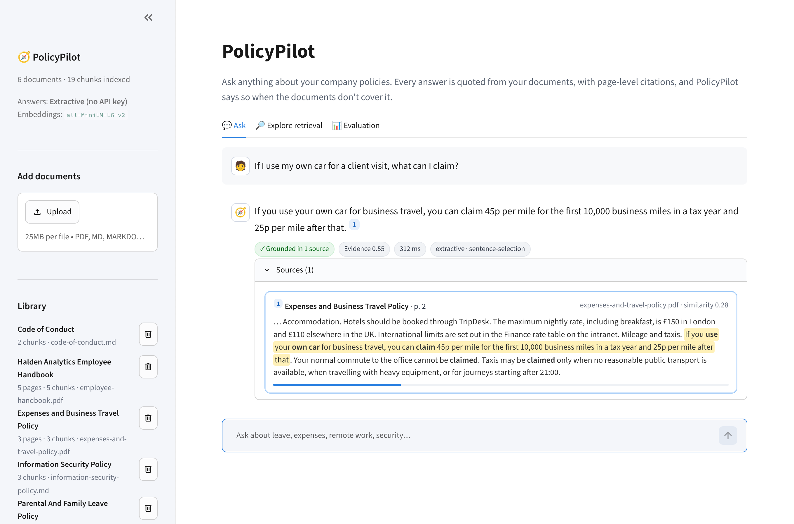
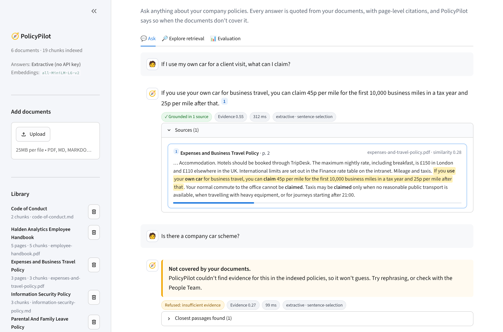
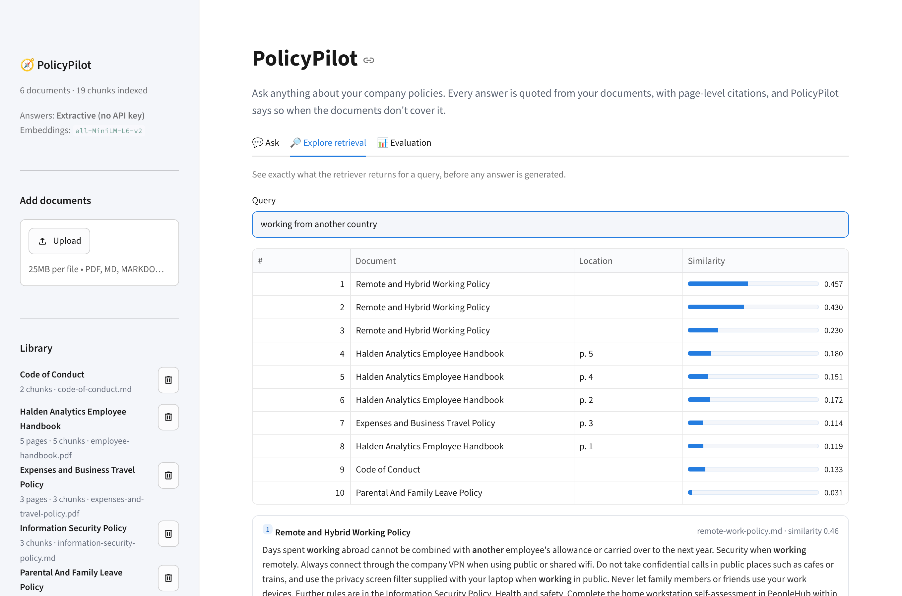
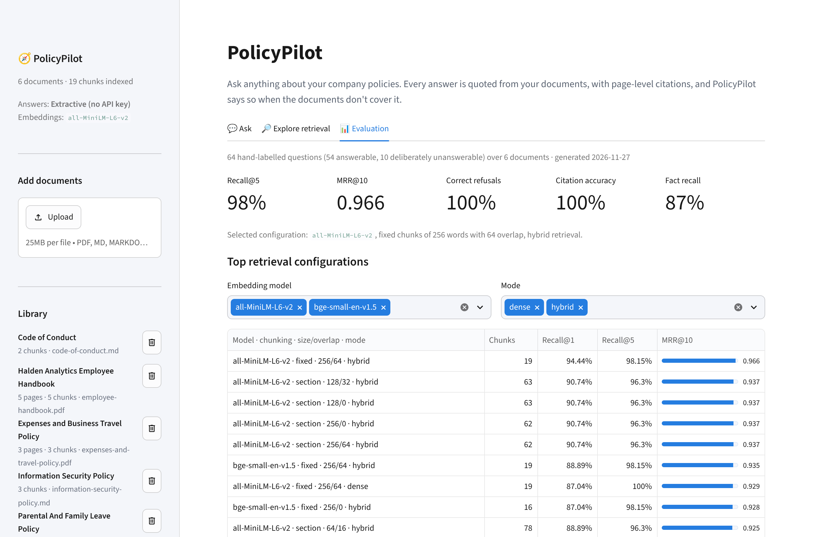
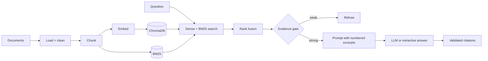

# PolicyPilot

[](https://github.com/Raed-7/policypilot/actions/workflows/ci.yml)


**Grounded answers to employee policy questions, with page-level citations and honest refusals.**

Staff lose time hunting through handbooks, expense rules and IT policies, and HR teams answer the same questions every week. PolicyPilot indexes a company's policy documents (PDF, Markdown or plain text) and answers questions in plain English. Every answer quotes the source document and page, and when the documents don't cover a question it says so instead of guessing.



## Highlights

- **Retrieval pipeline written from scratch**: loading, cleaning, sentence-aware chunking, embeddings, ChromaDB storage, BM25 keyword search and reciprocal rank fusion. No orchestration framework.
- **Citations you can check**: answers cite numbered excerpts, citations are validated against what was retrieved, and the UI shows the quoted sentence highlighted in its source passage with document title and page.
- **Refuses when the evidence isn't there**: a sentence-level evidence gate runs before generation. On the evaluation set it refused 10 out of 10 unanswerable questions.
- **Measured, not guessed**: a labelled set of 64 questions, a 48-configuration grid over embedding model, chunking strategy, chunk size, overlap and retrieval mode, and threshold calibration. The defaults come from these results.
- **Works without an API key**: pluggable Groq, Gemini and Ollama backends, with a deterministic extractive answerer that is used when no key is configured or when the LLM call fails.
- **Ready to run**: FastAPI service, Streamlit interface, Docker Compose with a persistent volume, 87 tests and a CI workflow.

## Results

Measured on 64 hand-labelled questions (54 answerable, 10 deliberately unanswerable) over the six sample policy documents. The full report is in [`evaluation/results/report.md`](evaluation/results/report.md).

**Retrieval** (selected configuration: `all-MiniLM-L6-v2`, 256-word chunks with 64-word overlap, hybrid search)

| Recall@1 | Recall@3 | Recall@5 | MRR@10 |
|---:|---:|---:|---:|
| 94.4% | 98.1% | 98.1% | 0.966 |

**End to end** (extractive answerer, no API key)

| Answer rate | Correct refusals | Fact recall | Citation accuracy | p50 latency |
|---:|---:|---:|---:|---:|
| 79.6% | 100% | 87.2% | 100% | 140 ms |

What the experiments showed:

- **Hybrid search beats dense-only search.** Adding BM25 through rank fusion improved MRR@10 in all 12 chunking configurations tested with MiniLM (by 0.012 to 0.061). It helps most on questions that hinge on exact terms such as `£150`, `TOIL` or `DeskFlow`.
- **The smaller model won.** `all-MiniLM-L6-v2` scored the best MRR (0.966) ahead of `bge-small-en-v1.5` (0.935 at best), and is faster to run.
- **Sentence-level evidence is a better refusal signal than chunk similarity.** It separated answerable from unanswerable questions with ROC AUC 0.935, against 0.876 for top-chunk similarity, because one relevant sentence gets diluted inside a long chunk.
- **The trade-off is deliberate.** The threshold refuses every unanswerable question at the cost of declining about one in five answerable ones that are phrased far from the policy wording. For policy guidance, "check with HR" is a better failure than a confident wrong answer.

Caveats: the question set is small and the threshold was tuned on it, so expect lower figures on unseen documents. Groundedness of the extractive answerer is 100% by construction, since it only quotes source sentences; the same metrics apply unchanged to an LLM backend once a key is configured.

## Quick start

**Docker (recommended)**

```bash
git clone https://github.com/Raed-7/policypilot.git
cd policypilot
cp .env.example .env          # optional: add GROQ_API_KEY or GEMINI_API_KEY
docker compose up --build
```

- Web app: http://localhost:8501
- API docs: http://localhost:8000/docs

On first start the API indexes the sample policies in `data/sample_policies`. Uploaded documents and the index are stored in the `chroma-data` volume and survive restarts. To use a local model instead of a hosted one, set `LLM_PROVIDER=ollama` and run `docker compose --profile ollama up`, then `docker compose exec ollama ollama pull llama3.2`.

**Local development**

```bash
python -m venv .venv && source .venv/bin/activate
make install                  # CPU PyTorch + dependencies
make api                      # FastAPI on :8000
make ui                       # Streamlit on :8501 (second terminal)
make test                     # full test suite
make eval                     # rerun the evaluation and rewrite the report
```

## Using the API

```bash
curl -s localhost:8000/ask -H "Content-Type: application/json" \
  -d '{"question": "If I use my own car for a client visit, what can I claim?"}'
```

```json
{
  "answer": "If you use your own car for business travel, you can claim 45p per mile for the first 10,000 business miles in a tax year and 25p per mile after that. [1]",
  "answerable": true,
  "confidence": 0.5453,
  "citations": [
    {"index": 1, "source": "expenses-and-travel-policy.pdf", "title": "Expenses and Business Travel Policy",
     "page": 2, "location": "p. 2", "score": 0.2838, "cited": true, "text": "..."}
  ],
  "provider": "extractive",
  "latency_ms": {"retrieval": 22.2, "generation": 230.3, "total": 252.5}
}
```

| Endpoint | Description |
|---|---|
| `POST /ask` | Answer a question. Optional `top_k`, `mode` (`dense` or `hybrid`) and `threshold`. |
| `POST /search` | Return ranked passages without generating an answer. |
| `POST /documents` | Upload one or more PDF, Markdown or text files (multipart field `files`). |
| `GET /documents` | List indexed documents with page and chunk counts. |
| `DELETE /documents/{doc_id}` | Remove a document and its chunks. |
| `GET /health` | Status, active LLM provider, embedding model and index size. |
| `GET /evaluation` | Latest evaluation results, used by the dashboard. |

## Screenshots

| Refusing an uncovered question | Retrieval explorer | Evaluation dashboard |
|---|---|---|
|  |  |  |

## How it works



1. **Ingestion.** PDFs are read page by page; section headings are recovered from the layout and running headers and footers are removed. Markdown keeps its heading hierarchy (for example `Equipment and allowances > Home office allowance`). Files are identified by content hash, so re-uploading the same file is skipped and an edited file replaces the old version.
2. **Chunking.** Whole sentences are packed into windows of a configurable word count, with trailing sentences repeated as overlap. Each chunk records its page and heading.
3. **Retrieval.** The question is matched against ChromaDB (cosine similarity) and a BM25 index, and the two rankings are fused with reciprocal rank fusion.
4. **Evidence gate.** Each sentence in the retrieved chunks is scored against the question. If the best score is below the calibrated threshold, the system refuses.
5. **Generation.** The excerpts are numbered and sent to the LLM with instructions to use only those excerpts, cite every claim and use a fixed refusal sentence otherwise. Without a key, the extractive answerer selects the most relevant sentences instead.
6. **Citations.** `[n]` markers are parsed, checked against the excerpts actually supplied and returned with document, page and heading.

More detail, including design decisions, is in [`docs/architecture.md`](docs/architecture.md).

## Evaluation

The evaluation set is in [`evaluation/dataset.jsonl`](evaluation/dataset.jsonl). Each answerable question records its source document, page (for PDFs), a verbatim evidence span and the key facts a correct answer must contain:

```json
{"id": "q026", "question": "What is the mileage rate for using my own car?", "answerable": true,
 "source": "expenses-and-travel-policy.pdf", "page": 2,
 "evidence": "45p per mile for the first 10,000 business miles", "expected_facts": ["45p", "25p"]}
```

Because relevance is defined by the evidence span rather than by chunk ids, the same labels work for every chunking configuration.

| Metric | Definition |
|---|---|
| Recall@k | Share of answerable questions whose evidence span is in the top *k* retrieved chunks |
| MRR@10 | Mean reciprocal rank of the first chunk containing the evidence |
| Answer rate / correct refusals | Share of answerable questions answered, and of unanswerable questions refused |
| Fact recall | Share of labelled key facts present in the answer |
| Citation accuracy | Answers citing the labelled document and page |
| Sentence support | Answer sentences whose closest source sentence has cosine similarity of at least 0.75 |
| Token precision | Answer content words that appear in the retrieved excerpts |

`python -m evaluation.run` runs the full grid (about a minute on a laptop CPU), writes `evaluation/results/latest.json` and regenerates the report. If an LLM key is configured, the end-to-end evaluation runs for both the extractive answerer and the LLM.

## Configuration

All settings are environment variables (see [`.env.example`](.env.example)).

| Variable | Default | Purpose |
|---|---|---|
| `LLM_PROVIDER` | `auto` | `auto`, `groq`, `gemini`, `ollama` or `extractive`. `auto` uses Groq or Gemini when a key is set. |
| `GROQ_API_KEY` / `GEMINI_API_KEY` | empty | Free-tier keys work. |
| `EMBEDDING_MODEL` | `sentence-transformers/all-MiniLM-L6-v2` | Any sentence-transformers model. |
| `CHUNK_STRATEGY` | `fixed` | `fixed` (per page) or `section` (never crosses a heading). |
| `CHUNK_SIZE` / `CHUNK_OVERLAP` | `256` / `64` | In words. |
| `RETRIEVAL_MODE` | `hybrid` | `hybrid` or `dense`. |
| `TOP_K` | `5` | Passages passed to the answerer. |
| `SCORE_THRESHOLD` | `0.2` | Minimum chunk similarity to keep a passage. |
| `EVIDENCE_THRESHOLD` | `0.54` | Minimum sentence similarity required to answer. |
| `SEED_SAMPLE_DOCS` | `true` | Index the sample policies when the store is empty. |

## Tests

```
$ make test
87 passed in 8.03s
```

- **Unit tests** cover text cleaning, PDF, Markdown and text loading, chunking edge cases, BM25, rank fusion, retrieval, citation parsing, refusal detection, the extractive answerer, each LLM provider's request and response handling (with HTTP mocked) and the evaluation metrics.
- **Integration tests** cover the pipeline (re-ingestion, document replacement, LLM failure fallback, uncited answers) and every API endpoint, using a deterministic hashing embedder so they run in seconds.
- **Model tests** (`-m slow`) run the real embedding model against the sample documents to check answers, citations and refusals. Skip them with `make test-fast`.

CI runs the test suite and then builds and starts the Docker Compose stack, checking both health endpoints.

## Project structure

```
policypilot/
├── policypilot/
│   ├── ingestion/        # loaders and text cleaning
│   ├── llm/              # Groq, Gemini and Ollama providers
│   ├── api/              # FastAPI app and schemas
│   ├── chunking.py
│   ├── embeddings.py
│   ├── vectorstore.py
│   ├── lexical.py        # BM25
│   ├── retrieval.py      # hybrid search and rank fusion
│   ├── generation.py     # LLM and extractive answering, citations
│   ├── prompts.py
│   └── pipeline.py
├── ui/                   # Streamlit app
├── evaluation/           # dataset, metrics, runner, results
├── data/sample_policies/ # fictional company policies
├── scripts/              # sample PDF builder
├── tests/
├── docker/
└── docs/
```

## Sample data

The sample documents describe Halden Analytics Ltd, a fictional UK company. They cover an employee handbook, expenses and travel, remote working, information security, a code of conduct, and parental and family leave, across PDF, Markdown and text. The PDFs are generated from `scripts/pdf_sources` with `make pdfs`.

## Limitations

- Scanned PDFs need OCR first; files without extractable text are rejected with a clear error.
- The BM25 index is rebuilt in memory after each change, which suits collections of up to tens of thousands of chunks.
- There is no authentication or per-user document access control; deploy behind your own gateway.
- The evaluation set is small and written by the author; it is a regression benchmark, not a general accuracy claim.

## Licence

MIT
