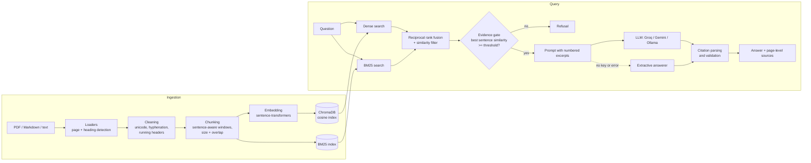

# Architecture

PolicyPilot is a retrieval-augmented question answering service. Every stage of the pipeline is implemented directly in the `policypilot` package, so each step can be inspected, tested and measured on its own.

## Components

| Module | Responsibility |
|---|---|
| `ingestion/loaders.py` | Reads PDF (per page, via `pypdf`), Markdown (heading hierarchy) and plain text (heading-like lines). PDF headings are detected from line layout; lines that repeat on most pages, such as running footers, are removed. Documents are identified by a hash of their content, so re-uploading an unchanged file is a no-op and a changed file replaces its previous version. |
| `ingestion/cleaning.py` | Unicode normalisation, ligature and quote repair, de-hyphenation, soft-wrap joining and page-number removal. |
| `chunking.py` | Packs whole sentences into windows of roughly *N* words, carrying trailing sentences forward as overlap. Two strategies: `section` (never crosses a heading) and `fixed` (one window per page or document). Each chunk keeps its page and heading for citations. |
| `embeddings.py` | `SentenceTransformerEmbedder` (normalised vectors, model-specific query prefixes) and a deterministic `HashingEmbedder` used by the test suite. |
| `vectorstore.py` | Thin wrapper over a persistent ChromaDB collection using cosine distance: upsert, query, per-document deletion and listing. |
| `lexical.py` | Okapi BM25 with light stemming, rebuilt from the vector store after each change. |
| `retrieval.py` | Dense search, optionally fused with BM25 using reciprocal rank fusion. The similarity filter is always applied to the dense cosine score, which is comparable across queries; RRF scores are not. |
| `generation.py` | Prompted LLM generation and an extractive answerer that quotes the best-matching retrieved sentences. Also parses and validates `[n]` citations and detects refusals. |
| `pipeline.py` | Orchestrates ingestion and question answering, applies the evidence gate, falls back to the extractive answerer when an LLM call fails, and records per-stage latency. |
| `api/` | FastAPI service: `/ask`, `/search`, `/documents` (upload, list, delete), `/health`, `/evaluation`. |
| `ui/` | Streamlit client of the API: chat with inline citations, a retrieval explorer and an evaluation dashboard. |
| `evaluation/` | Labelled question set, metrics, configuration grid search and threshold calibration. |

## Design decisions

**Answer only from evidence.** The prompt numbers each excerpt and requires a citation on every factual sentence, with an exact refusal sentence when the excerpts do not contain the answer. Citations returned by the model are validated against the excerpts actually supplied, so an out-of-range `[7]` is dropped rather than shown.

**A separate evidence gate.** Relying on the model to refuse is not enough: a weak retrieval still produces plausible-sounding text. Before generation, the pipeline embeds the sentences of the retrieved chunks and refuses if none is similar enough to the question. In the evaluation this sentence-level signal separated answerable from unanswerable questions better than whole-chunk similarity (ROC AUC 0.935 vs 0.876), because a single relevant sentence is diluted inside a long chunk. It also avoids paying for an LLM call that would only produce a refusal.

**Hybrid retrieval.** Policy questions mix paraphrase ("can I get a parking fine back?") with exact terms (`£150`, `TOIL`, `DeskFlow`). Dense embeddings handle the first and BM25 the second; rank fusion combines them without needing to calibrate their scores against each other. Hybrid mode improved MRR@10 over dense-only search in every chunking configuration tested with MiniLM.

**Works without an API key.** The provider interface has three hosted or local LLM backends and an extractive fallback, selected by configuration. The fallback keeps the demo, the tests and the evaluation fully reproducible offline, and is also used automatically if the configured LLM errors or times out.

**Configuration chosen by measurement.** Embedding model, chunking strategy, chunk size, overlap and retrieval mode were picked from a 48-configuration grid evaluated on the labelled question set (see `evaluation/results/report.md`), not by convention.

## Data flow for a question

1. The question is embedded and the top 20 candidates are fetched from ChromaDB; BM25 returns its own top 20.
2. Candidates are fused with RRF, dense scores are computed for BM25-only hits, chunks below the similarity floor are dropped and the top *k* are kept.
3. The evidence gate scores every sentence of the kept chunks against the question.
4. If the gate passes, the excerpts are formatted with their document, page and heading and sent to the LLM (or the extractive answerer).
5. Citations are parsed and mapped back to chunks; the response includes the answer, cited sources, all retrieved passages, the evidence score and stage latencies.

## Storage

ChromaDB persists to `CHROMA_DIR` (a named Docker volume in Compose). Chunk metadata stores the document id, file name, title, page, heading and position, which is enough to rebuild the BM25 index and document list on start-up without a separate database.
