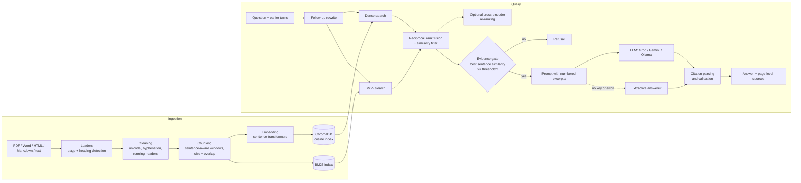

# Architecture

PolicyPilot is a retrieval-augmented question answering service. Every stage of the pipeline is implemented directly in the `policypilot` package, so each step can be inspected, tested and measured on its own.

## Components

| Module | Responsibility |
|---|---|
| `ingestion/loaders.py` | Reads PDF (per page, via `pypdf`), Markdown (heading hierarchy) and plain text (heading-like lines). PDF headings are detected from line layout; lines that repeat on most pages, such as running footers, are removed. Documents are identified by a hash of their content, so re-uploading an unchanged file is a no-op and a changed file replaces its previous version. |
| `ingestion/structured.py` | Word (`python-docx`) and HTML loaders. Heading styles and `<h1>`–`<h6>` become the heading path; navigation, scripts and page chrome are skipped; tables are turned into sentences such as "Injury: Minor cut; Action: …" so their rows can be retrieved and quoted. |
| `ingestion/cleaning.py` | Unicode normalisation, ligature and quote repair, de-hyphenation, soft-wrap joining and page-number removal. |
| `chunking.py` | Packs whole sentences into windows of roughly *N* words, carrying trailing sentences forward as overlap. Two strategies: `section` (never crosses a heading) and `fixed` (one window per page or document). Each chunk keeps its page and heading for citations. |
| `embeddings.py` | `SentenceTransformerEmbedder` (normalised vectors, model-specific query prefixes) and a deterministic `HashingEmbedder` used by the test suite. |
| `vectorstore.py` | Thin wrapper over a persistent ChromaDB collection using cosine distance: upsert, query, per-document deletion and listing. |
| `lexical.py` | Okapi BM25 with light stemming, rebuilt from the vector store after each change. |
| `retrieval.py` | Dense search, optionally fused with BM25 using reciprocal rank fusion, then optionally re-ranked by a cross-encoder. The similarity filter is always applied to the dense cosine score, which is comparable across queries; RRF and cross-encoder scores are not. |
| `conversation.py` | Detects follow-up questions ("what about part-time staff?") and turns them into standalone search queries, using the LLM when one is configured and the previous question otherwise. |
| `generation.py` | Prompted LLM generation and an extractive answerer that quotes the best-matching retrieved sentences. Also parses and validates `[n]` citations and detects refusals. |
| `pipeline.py` | Orchestrates ingestion and question answering, applies the evidence gate, falls back to the extractive answerer when an LLM call fails, and records per-stage latency. |
| `api/` | FastAPI service: `/ask` (with optional conversation history), `/search`, `/documents` (upload, list, delete), `/health`, `/evaluation`. |
| `ui/` | Streamlit client of the API: chat with inline citations, a retrieval explorer and an evaluation dashboard. |
| `evaluation/` | Labelled question set, metrics, configuration grid search and threshold calibration. |

## Design decisions

**Answer only from evidence.** The prompt numbers each excerpt and requires a citation on every factual sentence, with an exact refusal sentence when the excerpts do not contain the answer. Citations returned by the model are validated against the excerpts actually supplied, so an out-of-range `[7]` is dropped rather than shown.

**A separate evidence gate.** Relying on the model to refuse is not enough: a weak retrieval still produces plausible-sounding text. Before generation, the pipeline embeds the sentences of the retrieved chunks and refuses if none is similar enough to the question. In the evaluation this sentence-level signal separated answerable from unanswerable questions better than whole-chunk similarity (ROC AUC 0.937 vs 0.883), because a single relevant sentence is diluted inside a long chunk. It also avoids paying for an LLM call that would only produce a refusal.

**Hybrid retrieval.** Policy questions mix paraphrase ("can I get a parking fine back?") with exact terms (`£150`, `TOIL`, `DeskFlow`). Dense embeddings handle the first and BM25 the second; rank fusion combines them without needing to calibrate their scores against each other. Hybrid mode improved MRR@10 over dense-only search in every chunking configuration tested with MiniLM.

**Re-ranking as an option, not a default.** A cross-encoder reads the query and passage together, so it judges relevance more precisely than comparing two separate embeddings, at the cost of about 100 ms per query on a CPU. In the grid it lifted weaker configurations substantially (mean MRR@10 0.902 to 0.933) but lowered the best configuration, whose hybrid ranking was already near the ceiling, so it ships disabled and can be switched on with `RERANKER_MODEL` for larger or messier collections.

**Follow-ups without a chat model.** Follow-up detection is a cheap heuristic (short questions that open with "and", "what about" and similar, or lean on words like "it" and "that"). When an LLM is configured it rewrites the question into a standalone one; otherwise the previous question is prepended to the search query, which is enough for retrieval and the evidence gate to find the right passage.

**Works without an API key.** The provider interface has three hosted or local LLM backends and an extractive fallback, selected by configuration. The fallback keeps the demo, the tests and the evaluation fully reproducible offline, and is also used automatically if the configured LLM errors or times out.

**Configuration chosen by measurement.** Embedding model, chunking strategy, chunk size, overlap, retrieval mode and re-ranker were picked from a 96-configuration grid evaluated on the labelled question set (see `evaluation/results/report.md`), not by convention.

## Data flow for a question

1. If the question is a follow-up, it is rewritten into a standalone query using the earlier questions in the conversation.
2. The query is embedded and the top 20 candidates are fetched from ChromaDB; BM25 returns its own top 20.
3. Candidates are fused with RRF, dense scores are computed for BM25-only hits and chunks below the similarity floor are dropped. If a re-ranker is configured, the top 20 are re-scored by the cross-encoder. The top *k* are kept.
4. The evidence gate scores every sentence of the kept chunks against the question.
5. If the gate passes, the excerpts are formatted with their document, page and heading and sent to the LLM (or the extractive answerer).
6. Citations are parsed and mapped back to chunks; the response includes the answer, cited sources, all retrieved passages, the evidence score and stage latencies.

## Storage

ChromaDB persists to `CHROMA_DIR` (a named Docker volume in Compose). Chunk metadata stores the document id, file name, title, page, heading and position, which is enough to rebuild the BM25 index and document list on start-up without a separate database.
